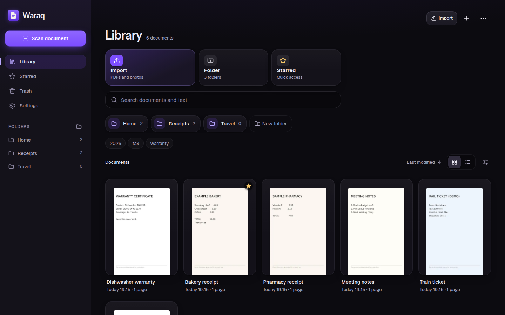
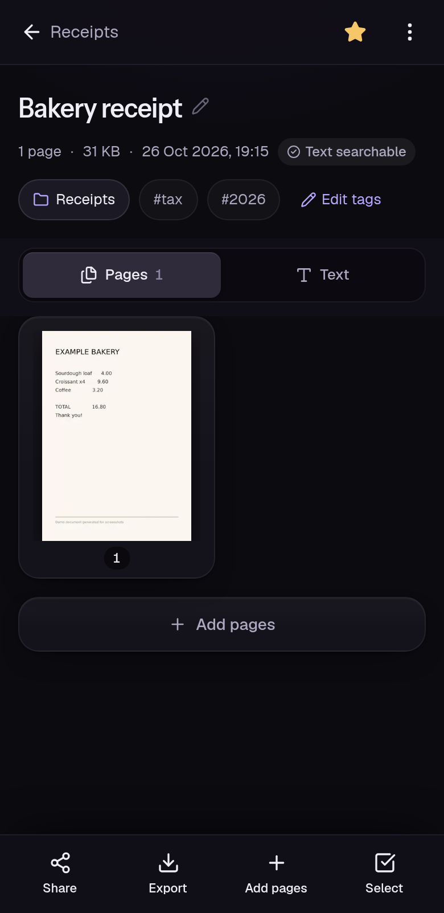
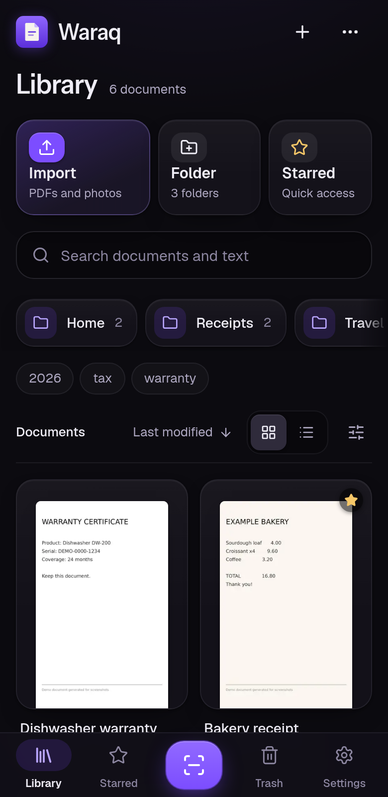
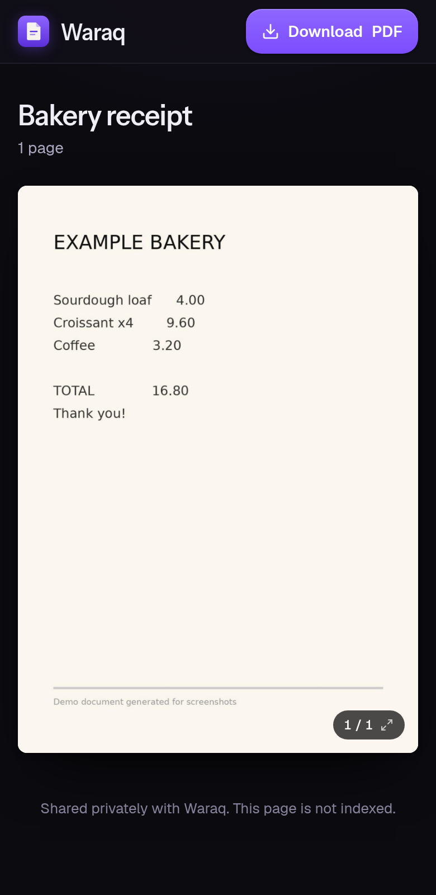
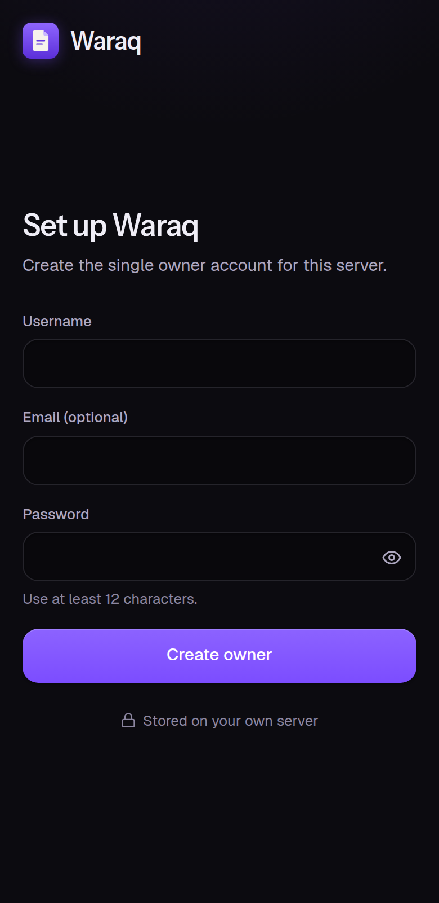

<div align="center">

# Waraq Community

**A private document scanner you host yourself.**

Scan paper with your phone, get a clean searchable PDF, and find it again in seconds, in Arabic or English.
One owner, one server, no telemetry.

[Quick start](#quick-start) · [Features](#features) · [Docs](#documentation) · [Security](SECURITY.md) · [License](LICENSE)



</div>

<p align="center">
  
  
  
  
</p>

## Why Waraq

- **Yours.** Documents live as plain PDFs in a folder on your server, next to one SQLite file.
- **Private by default.** Waraq has no analytics, no telemetry, no visitor cookies and no third-party scripts. The only outbound requests are the ones you turn on (Google sign-in and the Drive mirror).
- **Built for phones.** Installable PWA with its own in-browser scanner. Nothing to install from an app store.

## Features

**Scanning and import**
- In-browser scanner (OpenCV.js in a web worker): live edge detection, optional auto capture, batch capture, manual crop handles, perspective correction, rotation and filters (original, magic color, grayscale, black and white, lighten)
- Import PDFs and images, or send them from other apps through the PWA share target
- Background upload queue that survives reloads and flaky connections

**Documents**
- Canonical PDF per document with thumbnails and page images rendered on demand
- Page editing: reorder, rotate, delete, replace, re-crop and add pages; split, merge, extract, duplicate and compress
- Export as PDF (optionally password protected), a JPEG or PNG zip, or plain OCR text; print view

**Find things**
- OCR with OCRmyPDF and Tesseract (Arabic and English by default), queued in the background
- SQLite FTS5 full-text search over titles and OCR text, with Unicode-aware tokenization
- Folders (nested), tags, stars, trash with restore

**Share on your terms**
- Public links per document with expiry (1 hour to never), optional password, optional download, QR code
- Revoke one link or all links at any time; the shares list shows what is live

**Optional Google integration** (off until you configure it)
- Link a Google account to the owner for one-tap sign-in. Google can never create an account.
- Mirror every document as a PDF into a Waraq folder in your Google Drive, using only the `drive.file` scope. Your server stays the source of truth.

**PWA**
- Installable, offline app shell, update prompt when a new version is deployed

## Quick start

Requirements: Docker Engine with the Compose plugin, about 2 GB of RAM, amd64 or arm64.

```sh
git clone https://github.com/d7omdev/waraq.git && cd waraq
cp .env.example .env
sed -i "s/^SESSION_SECRET=.*/SESSION_SECRET=$(openssl rand -hex 32)/" .env
docker compose up -d --build
```

Open <http://localhost:3000>. The first visit shows **Set up Waraq**, where you create the owner account. Setup closes for good once the owner exists.

The container listens on `127.0.0.1:3000`. To use the scanner from a phone you need HTTPS (browsers only allow the camera on secure origins), so put a reverse proxy such as Caddy in front and set `PUBLIC_BASE_URL` to the public origin. See [Setup](docs/SETUP.md).

Data lives in the `waraq-data` Docker volume. Back it up with:

```sh
docker compose exec waraq node dist/ops.mjs backup --output /app/data/waraq-backup.tar.gz
docker compose cp waraq:/app/data/waraq-backup.tar.gz .
```

## Documentation

| Guide | What is in it |
| --- | --- |
| [Setup](docs/SETUP.md) | Docker, bare metal with systemd, reverse proxy, environment variables |
| [How-to](docs/HOWTO.md) | Everyday tasks: scanning, sharing, OCR, export, installing the PWA |
| [Operations](docs/OPERATIONS.md) | Backups, restore, updates, password reset, health checks, troubleshooting |
| [Google OAuth](docs/GOOGLE-OAUTH.md) | Optional Google sign-in and Drive mirror |
| [Architecture](docs/ARCHITECTURE.md) | How the pieces fit together, data layout, auth model |
| [API](docs/API.md) | HTTP routes |
| [Security model](docs/SECURITY.md) | Threat model and hardening notes |
| [Contributing](CONTRIBUTING.md) | Development setup, tests, pull requests |

## Commands

```sh
npm run dev              # development server on http://localhost:3000
npm run doctor           # check config, database integrity, owner and OCR tools
npm run migrate          # create or upgrade the database schema
npm run backup -- --output /safe/place/waraq.tar.gz
npm run restore -- --input /safe/place/waraq.tar.gz --confirm
npm run reset-password   # prompts twice without echo; or set WARAQ_NEW_PASSWORD
```

Passwords are never accepted as command-line arguments.

## Privacy promise

Waraq Community does not phone home. There is no usage analytics, error reporting service, telemetry or tracking cookie in the code, and Next.js telemetry is disabled in the Docker image. The browser talks only to your server. Your server talks to Google only if you configure Google sign-in or connect Drive.

## Tech

Next.js 16 (App Router) and React 19, TypeScript, Tailwind CSS 4, SQLite (better-sqlite3, WAL, FTS5), Better Auth, OpenCV.js, pdf-lib, sharp, qpdf, Poppler, OCRmyPDF and Tesseract.

## License

[GNU Affero General Public License v3.0](LICENSE). If you run a modified version for other people over a network, you must offer them the source.
