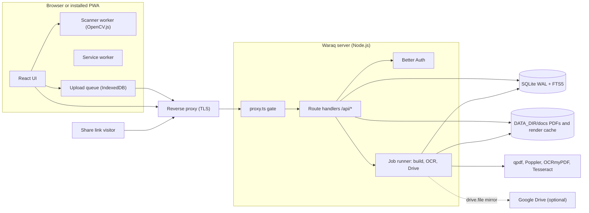
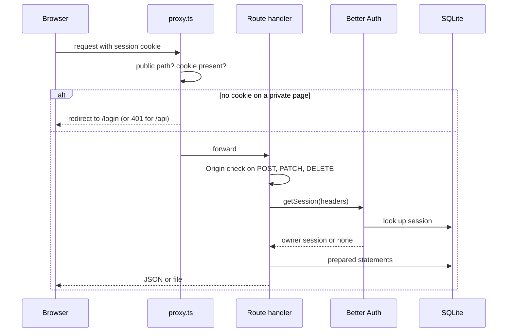
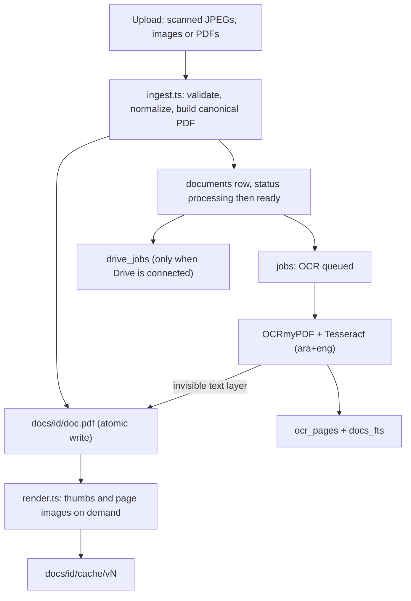

# Architecture

Waraq is a single Next.js 16 application (App Router, React 19) running as one Node.js process. It keeps all state in one SQLite database and one folder of PDFs under `DATA_DIR`.

## Overview



## Request path and auth



- `src/proxy.ts` is an optimistic gate. It only checks that a session cookie exists and lets public paths through (`/login`, `/setup`, `/s/<token>`, `/api/public/*`, `/api/auth/*`, `/api/health`, `/api/version`, `/api/setup`, PWA assets). Every route handler then validates the session against the database through the `api()` wrapper in `src/lib/server/http.ts`.
- Mutating requests must carry an `Origin` that matches `PUBLIC_BASE_URL` or the request host.
- Better Auth handles password sign-in (scrypt hashes), sessions (HttpOnly, SameSite=Lax, Secure on HTTPS, 180 days with daily refresh), Google linking and sign-in, and database-backed rate limits.

## Single owner

- `POST /api/setup` creates the owner inside a SQLite `BEGIN IMMEDIATE` transaction that first checks the user table is empty, so concurrent setup requests cannot create two owners. Afterwards it answers `409` forever and `/setup` redirects to `/login`.
- Better Auth is configured with `disableSignUp`, Google `disableImplicitSignUp`, a `before` hook that rejects `/sign-up/*` and `requestSignUp`, and a database hook that refuses every user insert. The catch-all auth route also returns `403` for sign-up and email-based flows (password reset by email, change email, delete user).
- There are no roles. Every authenticated request is the owner.

## Documents



- Each document has one canonical PDF. Page edits (rotate, reorder, delete, replace, split, merge) write a new PDF atomically and bump `version`. Renders are cached per version, so old caches are pruned instead of invalidated.
- Search uses an FTS5 table with the `unicode61 remove_diacritics 2` tokenizer over titles and OCR text, which handles Arabic diacritics and Latin accents.
- Trash is a `trashed_at` timestamp. Permanent delete removes the row, the PDF folder and the search entries, and queues a Drive trash job when the mirror is on.

## Sharing

A share row holds a 24-character random token, optional bcrypt password hash, expiry, download flag and view count. `/s/<token>` and `/api/public/s/<token>/*` resolve the token, answer `404` for unknown and `410` for expired or revoked links, and serve only that document. Password unlocks set a signed, HttpOnly cookie scoped to the share and bound to the current password hash, so changing the password invalidates earlier unlocks.

## Google Drive mirror

Optional, off by default. Drive state (client, encrypted refresh token, folder ids, per-document file ids) lives in `settings`, `drive_docs`, `drive_folders` and `drive_jobs`. A background queue uploads PDFs, mirrors folders, renames and moves files, and moves files to the Drive trash. Waraq never reads documents back from Drive. Secrets are sealed with AES-256-GCM using a key derived from `SESSION_SECRET` (HKDF).

## Client

- The scanner runs OpenCV.js 4.9 in a web worker (`public/scan-worker.js`) for edge detection, perspective warp and filters, so frames never leave the device until you save.
- Uploads go through an IndexedDB-backed queue that retries after network loss and resumes after a reload. If the browser refuses to store the queue (private mode or a full storage quota), the upload still runs from memory while the tab stays open.
- The service worker caches the app shell for offline use and versioned static assets. `/api/version` lets open tabs notice a new build and show an update prompt.

## Database

Tables created on a fresh install: `folders`, `documents`, `shares`, `jobs`, `settings`, `ocr_pages`, `docs_fts`, `drive_docs`, `drive_folders`, `drive_jobs`, plus Better Auth's `user`, `account`, `session`, `verification` and `rateLimit`. The schema is created with `CREATE TABLE IF NOT EXISTS` at startup (`npm run migrate` does the same offline). WAL mode, foreign keys and a busy timeout are enabled. A build-time guard keeps `next build` from opening the database.

## Source layout

```text
src/app/            pages and route handlers (App Router)
src/components/     UI: library, document view, scanner, settings, sharing
src/lib/client/     browser code: API client, upload queue, scanner pipeline, PWA helpers
src/lib/server/     server code: db, auth, ingest, render, OCR, shares, Drive
src/proxy.ts        optimistic auth gate
public/             service worker, scanner worker, OpenCV.js, icons
scripts/            ops CLI (migrate, doctor, backup, restore) and reset-password
tests/server/       Vitest suites against a temporary DATA_DIR
```
